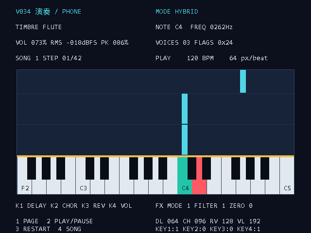

# Tang Primer 20K 多音色乐器 · V034

当前仓库是 **V034 的源码、配套 FPGA/ESP32 固件、离线验证材料与交接文档**。上一份已公开版本是 V015（`c07e7d1`）；本次直接更新到 V034，没有上传中间版本目录、对话记录、账号配置或工具链安装包。

**状态：FPGA 综合/布局布线与时序检查通过，ESP32 编译通过，软件仿真通过；V034 尚未烧入两块板，混合扫弦尚待实机验收。** 此前实机确认的是 V033。PCM5102A 模拟输出无声仍未解决；32 路验证引擎保留，但当前顶层没有启动入口。数字模块存在不等于整机功能已经验收。

## 先读这些

| 内容 | 入口 |
|---|---|
| 相比 GitHub 上一版增删了什么、重点关注什么 | [V015 → V034 更新说明](docs/V015到V034更新说明.md) |
| 给交接者：架构、模块职责、接口与维护重点 | [项目架构与模块说明](docs/项目架构与模块说明.md) |
| 给交接者的 AI：阅读顺序、修改入口、约束和验证边界 | [AI 快速上手](docs/AI快速上手.md)及[AGENTS.md](AGENTS.md) |
| 四键、三种模式和手机接线/操作 | [V034 操作说明](docs/V034_面板长按与键盘扫弦混合.html) |
| ESP32 固件部署与手机连接 | [ESP32 README](esp32_phone/README.md) |
| 参数范围、真实回读、重试与兼容要求 | [手机 UART 协议](docs/phone_protocol.md) |
| 编译、时序、离线回归与待验收范围 | [验证说明](verification/README.md) |

## 当前功能

- **2 种旋律音色**：长笛、拨弦；**32 个独立相位/包络声部**共享合成流水线。音色数不等于声部数。
- MIDI 琴键接收完整半音音高、力度、弯音和延音；4 个 Pad 触发打击乐。屏幕按实物画 **F2–C5 / MIDI 41–72** 的 32 个黑白键。
- `KEY` 只用琴键直接发声；`STRUM` 由琴键选择和弦、光电触发扫弦；`HYBRID` 同时直接演奏和叠加光电拨弦。两来源共用 32 声部，同音的松键事件按来源隔离。
- K1/CC93、K2/CC91、K3/CC71 分别调 Delay、Chorus、Reverb 强度，K4/CC74 调总音量；旋钮有软接管。**三种效果共用一个引擎，一次启用一种**。
- ADS1115 只轮询两片 FSR：A0 调明亮度，A1 调拨弦阻尼。滑杆停用，A2/A3 不参与生产控制。
- 四个独立共地按键负责切页、开始/暂停、重播和选曲；长按 1 切音色，长按 2 切输入模式，约 0.8 秒后松手执行。旧矩阵/电容菜单不再是生产输入。
- HDMI 下落式演奏指引、三首练习曲、中文多页状态界面。32 频率验证路径的内部引擎与页面仍保留，现场入口待恢复。
- 手机通过 ESP32 Wi-Fi 网页调参数；ESP32 用独立 UART 与 FPGA 通信，不参与音频合成。标准外接 I2S 与板载 PT8211 输出并存。

## 工程与固件

| 路径 | 用途 |
|---|---|
| `instrument_handoff.gprj`、`build.tcl` | Gowin 工程；顶层 `src/top.v`，器件 GW2A-LV18PG256C8/I7 |
| `src/`、`assets/` | RTL、引脚/时序约束、波表、字模和生成资产 |
| `instrument_handoff.fs` | **V034 FPGA 固件**，UserCode `0x000099D5` |
| `firmware/esp32/` | 与 V034 匹配的 classic ESP32 应用、bootloader、分区表 |
| `esp32_phone/` | ESP32 网页、协议桥、构建脚本；core 2.0.17 |
| `tests/`、`scripts/` | 当前离线回归、少量旧行为对照夹具、生成器与构建工具 |
| `tools/` | 显式操作的串口/音频测试和离线分析；不会被默认离线检查连接硬件 |
| `manifest.json`、`checksums.json` | 固件、构建输入及发布文件的 SHA256 身份 |
| `impl/instrument_handoff_process_config.json` | 保留构建选项；其余 `impl/` 输出不入库 |

主时钟 27MHz，采样使能 93750Hz。当前资源为 Logic **16940/20736**、CLS **9510/10368**、Register **8100/16173**、BSRAM **27/46**、DSP **15.75/24**。Setup/Hold 违例均为 0，主时钟报告 Fmax 为 30.303MHz；资源和余量须在每次修改后重新检查。

FPGA SHA256：`4286301056b4370119f9ec409b112ca28c9e51ae49c21700025ee66bf6c63831`。

## 离线检查

需要 Python 3.11+、Icarus Verilog（`iverilog` 与 `vvp`）和 C++17 编译器。浏览器测试另外需要 Node.js 与 Playwright。**以下命令不烧录、不访问串口、不录音。**

```sh
python -m pip install -r requirements.txt
python scripts/verify_release.py
python scripts/run_release_checks.py
```

Icarus 在 PATH 中可直接使用；否则把 `IVERILOG_BIN` 设为同时包含两个程序的目录，例如 PowerShell `$env:IVERILOG_BIN = '你的Icarus/bin目录'`。原开发机的私人目录不是运行依赖。

增加实像素/跨时钟域和手机网页验证：

```sh
npm ci
npx playwright install chromium
python scripts/run_release_checks.py --ui --web
```

Linux 还需安装系统的 Icarus/C++ 编译器及 Chromium 运行依赖；可用 `npx playwright install --with-deps chromium`。已有兼容浏览器时，通过 `PLAYWRIGHT_CHROMIUM_EXECUTABLE` 指定路径。输出写入被 Git 忽略的 `validation/` 等目录。旧 bench 是兼容/对照材料，**当前推荐入口是 `run_release_checks.py`**，不能把任意历史脚本的通过当成本版验收。

## FPGA 构建与实机交接

用 Gowin 1.9.12.04 打开根目录 `.gprj` 并运行 Run All，或设置 `GOWIN_HOME` 后运行 `python scripts/build.py`。许可服务必须可用；许可证连接失败不等于 RTL 错误，也不能将旧 `.fs` 改名冒充新构建。新输出在 `impl/pnr/instrument_handoff.fs`，构建后运行 `python scripts/summarize_build.py` 核对资源、时序与输入哈希。

需要断电保留时，选择外部 SPI Flash 的擦除、编程及校验流程，随后重载/断电重启验证；仅写 SRAM 不会在下次上电保留。烧录动作独立于本次 GitHub 发布。

**V034 FPGA 与 ESP32 要配套升级**：输入模式参数新增值 2，旧 ESP32 只接受 0/1。实机优先检查四键长短按、模式/音色回读、同音双来源释放、真实光束方向、FSR 表情，以及 PCM5102A 输出和 32 路验证入口。当前 ESP32 网页内嵌帮助仍有旧引脚提示，**接线以 [multi_tone.cst](src/multi_tone.cst) 和交接文档的 L9/N8 为准**，PMOD1 暂不使用；修正文案需重新编译 ESP32，不能只改源码却沿用旧 bin。

下图是 RTL 离线像素捕获，**不是实物显示屏验收照片**：


