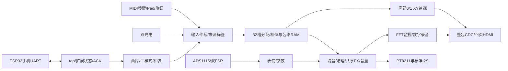

# V047 项目架构与模块说明

生产入口为 instrument_handoff.gprj → src/top.v。发布身份见 [manifest](../manifest.json)，相对上一版变化见 [V034→V047](V034到V047更新说明.md)。FPGA负责音频、教学与显示；ESP32负责手机网页、协议桥及文件存储，不合成声音。

| 模块 | 职责与重点 |
|---|---|
| top / instrument_audio_top | 参数单一所有者、复位、测试所有权、输入/音频/显示连接；音频不等HDMI锁定 |
| instrument_inputs / performance_input_hub | MIDI、光电、控制仲裁；KEY/STRUM/HYBRID，来源1/2/3的同音不能互相关门 |
| midi_keyboard / midi_uart_rx | 31250bps、运行状态、力度、弯音、CC、延音、Pad；位图优化保留0–127语义 |
| optical_strum / strum_player | 空闲极性、滤波、方向/经过时间、最多6音扫弦；单束后备等待150ms是现存延迟边界 |
| ads1115_reader / pressure_expression | 两路FSR采样、恢复、基线、平滑；A0明亮度/A1拨弦阻尼；原始数值不是kg |
| voice_allocator / wavetable_synth | 32份音符/来源/gate/phase/envelope状态，共享计算与ROM；PHASE_RAM=1才是生产分支 |
| performance_mixer / drum/snare/hat_voice | 旋律与四鼓混音；鼓组+6dB、符号扩展、限幅；不能通过多谐波虚报声部 |
| audio_effects / midi_control_bank | Delay/Chorus/Reverb单条共享路径、独立强度记忆、软接管；K4总音量 |
| audio_cleanup / audio_controls / headphone_mute_guard | 去直流、平滑/静音与滤波；不保证消除供电/接地模拟噪声 |
| pt8211_driver / pcm5102a_i2s | 同一最终PCM双输出，PT右对齐与标准I2S的MSB对齐不同；设计Fs93750Hz |
| four_button_display_control | 四键同步/消抖、松手确认、长短互斥；多键取消，上电按住需先全松 |
| phone_control_link / phone_extension_state | 参数ACK、扩展能力、曲谱/映射/录音命令、实际状态与事务边界；手机UART1Mbps |
| custom_score_ram / midi_keymap_ram | 双bank曲谱与映射，CRC/提交/激活；页面不能把未确认请求显示为已应用 |
| piano_roll_score / song_library | 三首内置练习曲；自定义为第四槽，断电后RAM需从ESP重新激活 |
| guide_play_modes / guide_chord_modes / guide_chord_events | 自动/逐音/固定BPM；和弦新按+全held；来源3先Off后On保护公共音 |
| piano_roll_guide / piano_roll_renderer | MIDI41–72真实黑白键、四音同组落条、帧边界更新与像素管线 |
| hdmi_live_display / hdmi_status_cdc | 整包握手跨域，状态一致性；不能换成逐位同步；显示仅消费监视值 |
| audio_fft512 / audio_visual_buffers / audio_visual_renderer | FFT512和双声部XY、自适应幅度、双缓冲；不是校准频谱仪或外部模拟回采 |
| oscillator_test_control / frequencies | 1/4/8/16/32验证、400+97*iHz、逐路0.5s OFF/0.5s ON、测试/演奏清理 |
| remote_debug_link | 独立FTDI诊断115200bps，与手机UART物理分开；数字返回不能替代模拟测量 |
| ESP bridge_core / recording_uart | 基础可靠控制与录音流接收，超时/ACK/重试、缓存与错误状态 |
| ESP v041_core/json/runtime/ui | 曲谱/映射格式、调度、WiFi HTTP、文件与扩展页面；两端能力字一致 |
| ESP wav_view | 顺序数据文件的虚拟WAV文件头；不得改回原位重写大文件头 |

27MHz主域每288clk一个采样帧；音频16位二补码。视频25.2MHz/TMDS126MHz各自复位同步。32相位与包络独立；共享运算器不等于共享一个状态。三个音符来源、延音尾音、raw held、显示亮键与busy必须区分。

四页：0演奏、1曲库、2FFT/XY、3诊断。录音以最终数字PCM经6点平均降采样，15625Hz/mono/16bit/30s；FFT以8点平均降采样后做512点，Fs11718.75Hz、bin约22.89Hz，XY取FX前声部0/1。两个监视功能都不等同于模拟I2S/DAC验收。

生产停用滑杆、MCP3208、电容菜单与旧矩阵演奏；保留的legacy文件仅用于兼容/对照。当前CST、手机1Mbps、配套两端固件是接手第一检查项。详细接线见 [部署](V047_接线与部署.md)。CLS只余15，每次RTL修改须重跑布局、时序、音频预算及相关回归。
