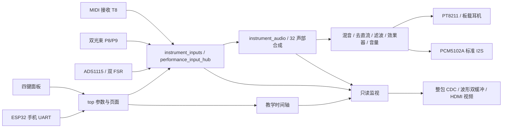

# V034 项目架构与模块说明

本文说明当前工程结构、模块职责和维护重点。相对上一份 GitHub V015 的变化见 [更新说明](V015到V034更新说明.md)，协议见 [phone_protocol.md](phone_protocol.md)，固件身份见 [manifest.json](../manifest.json)。

## 当前状态

V034 FPGA 与 classic ESP32 均已编译，离线回归通过；**本版未烧录、未做实机混合演奏验收**。FPGA UserCode 为 `0x000099D5`。此前实物使用 V033，已有板载 MIDI 琴声、HDMI 和手机 UART 连通反馈；外接 PCM5102A 模拟输出仍未确认有声。

生产配置为两音色、32 旋律声部、4 种 MIDI 打击乐、双 FSR 表情、双光束扫弦、四键面板及手机参数控制。没有 FPGA USB-MIDI Host、显示屏 USB 触控或 HDMI 音频。

## 顶层数据流

`src/top.v` 是实际生产入口。音频主链路不等待 HDMI 锁定或页面渲染；显示仅消费状态快照和波形。ESP32 只传控制参数，不计算或传输音频。

## 时钟、事件与数字格式

- FPGA 主时钟 27MHz；音频每 288 个主时钟产生一次采样使能，即 **93750Hz**。`sample_tick`、`frame_done` 是同域使能，不是供其它 always 块直接使用的新时钟。
- 视频像素 25.2MHz、TMDS 串行 126MHz，由 `hdmi_clocks` 产生；各域分别同步释放复位。音频不依赖视频 PLL 锁定。
- 音符号 7 位，力度 8 位，PCM 为 16 位二补码；生产音色只用 0/1，但部分外部兼容接口仍为 4 位。
- 普通旋律是 **32 份独立相位、包络和音符状态，共享运算与波表**。不能将共享流水线误写为只有一个振荡器，也不能把音色数量当声部数。
- 跨模块事件在 clk 域传递；MIDI/扫弦的 valid/ready 保持契约用于防止松音丢失。菜单事件为单周期控制脉冲，不产生音乐音符。

## 模块分工

以下按功能列出生产主路径。完整工程文件清单以 [instrument_handoff.gprj](../instrument_handoff.gprj) 为准。

| 模块/文件 | 内容 | 维护重点 |
|---|---|---|
| `top.v` | 连接音频、面板、手机、教学和显示；保存实际输入模式/滤波/静音参数 | 参数状态单一所有者；手机同拍绝对 SET 优先；回读实际状态 |
| `instrument_audio_top.v` | 配置后复位、输入/音频封装、正常演奏与测试所有权交接 | 保持渐变清音、`test_owned` 与 `normal_input_ready` 边界 |
| `instrument_inputs.v` | 生产输入选择、ADC、FSR、音色、控制 bank、诊断串口 | `DISPLAY_TOUCH_ONLY=1` 是历史命名，不表示触摸启用；生产不实例化滑杆输入 |
| `ads1115_reader.v`、`i2c_byte_master.v`、`i2c_bus_recovery.v` | I2C 配置与采样、超时/恢复 | 生产 `PRESSURE_ONLY=1` 只采 A0/A1；开漏与上拉；避免 ADC 故障阻断 MIDI |
| `pressure_expression.v` | 无载基线、死区、缩放和平滑后的双表情 | 输出是控制码，不是 kg；检查校准与失联重学，不凭原始变量名解释功能 |
| `midi_uart_rx.v`、`midi_keyboard.v` | 31250bps MIDI、运行状态、Note、力度、PC、CC、延音与 Pad | 通道 1 旋律/通道 10 打击；velocity=0 Note On 释放语义；松音和溢出恢复 |
| `performance_input_hub.v` | 本地兼容/MIDI/光电事件仲裁、三种模式、来源标签 | SOURCE1 MIDI 与 SOURCE2 光电同音隔离；模式切换 Panic，取消旧扫弦队列 |
| `optical_strum.v` | 同步/过滤、学习空闲极性、双光束先后与经过时间 | 原始电平不直接等于遮光；先看 ready/raw/blocked，再看方向 |
| `strum_player.v` | 快照最多 6 个按住音符、分步扫弦及对应松音 | valid/ready 背压、快速重扫清理、完整释放；无琴键默认 C4/E4/G4/C5 |
| `midi_control_bank.v` | 四旋钮软接管、三效果独立强度记忆、ADSR 与手机参数 | K1–K3 改强度并选择对应效果；不是三个并行效果；手机覆盖后重新接管 |
| `voice_allocator.v` | 32 槽音高/力度/音色/来源元数据、gate 与 retrigger | 优先空槽、再释放尾音、最后轮转抢占；Note Off 只释放同来源同音槽 |
| `wavetable_synth.v`、`note_table.v` | 相位累加、半表恢复、包络、音高控制及共享合成流水 | `PHASE_RAM=1` 的同步读取延迟/有效位；不能减少一拍就假定取到正确声部 |
| `performance_mixer.v`、`audio_mix.v`、`drum_voice.v`、`snare_voice.v`、`hat_voice.v` | 旋律、底鼓/军鼓/开闭镲混合 | 符号扩展、位宽和限幅；合声发杂先查溢出和电平，不能直接归因波形相加 |
| `instrument_audio.v` | 声部→混音→清理/表情/效果→音量→输出 | 32 声部必须在采样预算内完成；监视 overrun；保持测试/正常输入复位边界 |
| `audio_cleanup.v`、`dc_blocker.v`、`audio_controls.v`、`headphone_mute_guard.v` | 去直流、平滑、滤波、静音/切换处理 | 数字降噪不保证消除供电/接地/DAC 的模拟噪声；动态量要防溢出 |
| `audio_effects.v` | 单条共享效果路径：Delay/Chorus/Reverb | 共享历史 RAM；模式切换清理尾音；feedback 的实际稳定范围由引擎限制 |
| `pt8211_driver.v` | 板载 16 位右对齐立体声串口 | 它不是标准 I2S；不要把该 DIN 的 MSB 对齐直接用于 PCM5102A |
| `pcm5102a_i2s.v` | 同一 PCM 的标准 I2S 双声道复制输出 | LRCK 翻转后延迟一个 BCK 才是新声道 MSB；右声道 LSB 跨帧槽不能丢 |
| `four_button_display_control.v` | 四键逐路同步/消抖，短按与长按、松手执行 | 多键/换键取消；上电按住和测试退出需全松；长按不得补发短按 |
| `phone_control_link.v` | 独立 115200bps 手机请求/ACK、范围校验与真实回读 | 输入模式允许 0/1/2；仅验证成功才 SET；不可把请求值当生效值回传 |
| `remote_debug_link.v` | 原 FTDI 诊断与虚拟输入接口 | 独立于手机 UART；虚拟输入有所有权，不等于物理 ADC 已变化 |
| `instrument_telemetry.v` | 峰值、RMS、音高摘要与活动声部等显示量 | 代表音符不是 32 路频谱；数字 PCM 统计不是模拟耳机噪声测量 |
| `piano_layout.vh`、`piano_roll_score.v`、`piano_roll_guide.v` | F2 开始的显示布局、三首固定曲谱、视觉时间轴 | 显示窗 MIDI41–72；曲目保留原音高；当前不等正确按键，也不自动伴奏 |
| `piano_roll_renderer.v`、`hdmi_compact_dashboard.v` | 黑白键、按住高亮、下落音符及四页中文界面 | 19 白键/13 黑键；管线坐标/色值/消隐同步，不能以绘制假图代替 RTL 像素测试 |
| `hdmi_live_display.v`、`hdmi_status_cdc.v`、`wave_scope.v` | 整包状态跨域与波形双缓冲 | 生产状态 339bit；保留 242/252/289/338 等兼容布局；只在帧边界发布同一快照 |
| `hdmi_clocks.v`、`video_timing.v`、`tmds_encoder.v`、`hdmi_tx.v`、`hdmi_ui_font.v` | 时钟、640×480 视频、TMDS 和字模 | 视频/同步信号延迟匹配；HDMI 只发视频，没有音频包或 USB 触控 |
| `oscillator_test_control.v`、`oscillator_test_frequencies.v` | 32 个不同频率验证与演奏交接引擎 | **当前 top 将 ui_test_keys 固定为 0，没有生产启动入口；需补回** |

`matrix_keypad`、`slider_controls`、模拟触摸/MCP3208、旧菜单及 `pressure_adaptive` 等仍作为兼容分支或测试对照保留。工程里有文件不等于当前参数下启用。生产 FSR 不再触鼓；A1 表情在音频层传给拨弦 `damping`，旧 `pressure_vibrato` 名称不能据此解释成揉弦。

## 固定交互与引脚

| 功能 | 当前分配 |
|---|---|
| MIDI 接收 | PMOD0 T8，外置接收模块实物 TX → FPGA RX；31250bps |
| 光电 A/B | PMOD0 P8/P9；发射、接收均供电并对准；按模块要求上拉接收 OUT |
| ADS1115 | PMOD2 D14=SCL、E15=SDA；A0/A1 双 FSR，A2/A3 停用接地 |
| PCM5102A I2S | PMOD2 B14=BCK、A15=LRCK、B13=DIN |
| 面板 1/2/3/4 | PMOD3 A11/B11/N6/D11；按下接公共 GND，不接 VCC |
| 手机 UART | PMOD3 L9 RX ← ESP D17；N8 TX → ESP D16；公共 GND，115200bps |
| FTDI 调试 | T13 RX、M11 TX，115200bps，与手机接口独立 |

面板短按为切页/开始暂停/重播/选曲；长按 1 切两音色、长按 2 轮换 KEY→STRUM→HYBRID，默认约 0.8 秒后松手执行。K1/CC93 Delay、K2/CC91 Chorus、K3/CC71 Reverb、K4/CC74 音量；软接管后再继续改变才生效。

PMOD1 曾有异常报告，当前避开它。引脚冲突以 [multi_tone.cst](../src/multi_tone.cst) 为准。网页内嵌帮助残留 T11/P11 旧文字，不能照旧提示接线；修改网页后必须重编译 ESP32 并更新二进制哈希。

## 修改时必须守住的边界

1. UI/手机只改参数；音符来源和音频所有权不得由显示页猜测。模式切换清旧声部与效果尾音，切后松键再弹。
2. 输入模式 0/1/2 同时影响 FPGA、HDMI、ESP bridge 限值、网页和预设；升级一边会导致旧 ESP 拒绝 HYBRID 回读。
3. FSR 校准、MIDI held、sustain 尾音、扫弦 gate 和屏幕高亮是不同状态；不得合成一个“按下”标志。
4. 扩展先查 CLS、采样帧预算和三个时钟域的时序，不能只看 LUT。当前 CLS 9510/10368，余量 858。
5. 不删生成资产的原始波表/字模基准；编辑 assets 后运行对应生成器与检查，再重新编译。

验证入口为 `python scripts/run_release_checks.py`，可追加 `--ui --web`。具体覆盖见 [verification/README.md](../verification/README.md)。当前优先待办是 32 路验证启动入口、手机帮助引脚修正、V034 双固件实机验收及 PCM5102A 模拟无声；不把旧实机反馈签给新固件。
